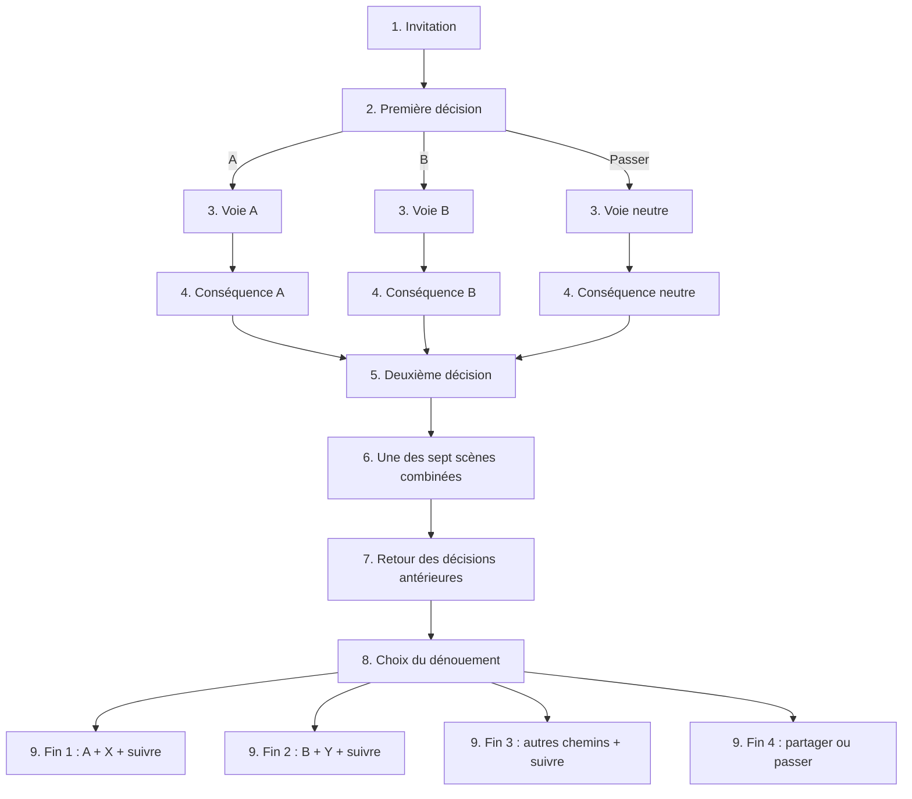

# Les embranchements de V26

## Structure des trois récits

Chaque histoire possède 22 nœuds possibles. Un chemin en visite neuf ; les embranchements remplacent des scènes, ils n’en ajoutent pas.

| Scène du parcours | Nœuds possibles | Rôle |
| --- | ---: | --- |
| 1 | accueil | Entrée, premier joueur tiré au sort |
| 2 | pacte | Décision A/B, ou voie neutre Z par passage |
| 3 | voie-A, voie-B, voie-Z | Défis distincts selon la première décision |
| 4 | echo-A, echo-B, echo-Z | Première conséquence du pacte |
| 5 | bascule | Décision X/Y, ou voie neutre N |
| 6 | carrefour-AX, AY, BX, BY, ZX, ZY ou N | Défi déterminé par la combinaison des décisions |
| 7 | retour, avec variantes conditionnelles | Conséquence différée et inversion cohérente de l’initiative narrative |
| 8 | denouement | Suivre le chemin ou conclure librement |
| 9 | fin-1, fin-2, fin-3 ou fin-4 | Dénouement propre au récit |

Passer une scène ordinaire utilise la sortie neutre vers le chapitre suivant. Passer l’une des décisions fixe un état neutre explicite ; les textes n’attribuent pas de promesse ou de confidence inexistante. La fin libre reste toujours possible. Si une préparation de la scène 3 ou 6 a été passée ou remplacée, sa conséquence en scène 4 ou 7 affiche une alternative autonome, sans demander ce qui n’a pas été préparé.

## Le pouvoir change de mains

A : proposer un cadre. B : confier la surprise. Z : construire à deux sans guide. X : l’audace ; Y : la confiance. Les cadres, personnages, demandes reformulées et confidences fictives sont des scènes distinctes. À la septième scène, le guide choisi au début change : le cadre revient à celui qui l’avait reçu, ou l’initiative offerte revient à son auteur. Sans guide initial, l’initiative reste commune.

Fins : **Le cadre devenu invitation**, **La confiance derrière le masque**, **Un pacte à réinventer**, **L’égalité choisie**.

## Le secret que tu ignores

A : la piste d’un souvenir ; B : celle d’un souhait futur ; Z : une fiction commune. Le choix est discret à la deuxième scène. La quatrième révèle seulement la catégorie, jamais une confidence enregistrée. X explore la piste immédiatement ; Y prépare un mot, une phrase ou un écho qui reviendra à la septième scène. Le passage N respecte le silence. Les réponses du partenaire changent selon la combinaison.

Fins : **Le souvenir partagé autrement**, **Demain reste une invitation**, **L’enveloppe à deux voix**, **Le secret a le droit de rester**.

## La soirée imprévisible

A : le partenaire désigne un objet ; B : le choix vient d’une intuition ; Z : un objet inventé. X explore un détail sensoriel ; Y crée un événement de fiction. Les scènes combinées deviennent inventaire, cadeau, musique/couleur, matière ou événement impossible. Au retournement, le partenaire peut modifier le sens de l’objet selon son origine et son usage précédent.

Fins : **Le talisman du hasard**, **Le cadeau qui revient**, **Le musée de votre soirée**, **L’ordinaire retrouvé**.

## Progression et durée

Les temps indicatifs par scène sont 55, 60, 85, 90, 60, 90, 90, 90 et 90 secondes : 710 secondes au total. Ils servent de repères et n’empêchent jamais un choix immédiat. La progression va de la mise en place à l’invention, puis aux décisions plus personnelles, à leur conséquence et au final choisi. Les préférences peuvent remplacer une invitation par une alternative au même stade, sans ajouter de détour.

Les initiatives de jeu alternent strictement entre Sylvain et Steph. Le rôle narratif de guide, lorsqu’il existe, est un état distinct : il peut s’inverser sans donner à un joueur un droit sur l’autre.
